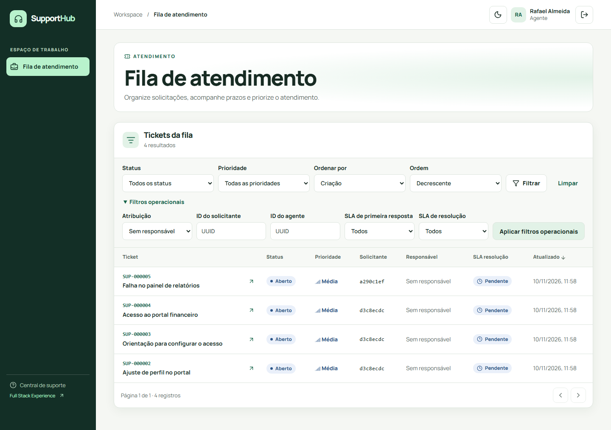
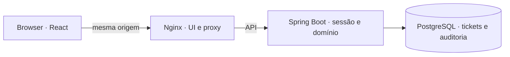

# SupportHub

## Português

SupportHub é uma central de atendimento corporativo com API Spring Boot e interface React. A **v0.1.0 — Backend Foundation** é a release estável. A **v0.2.0 — Full Stack Experience** está em desenvolvimento como `0.2.0-dev`.



### Espaços de trabalho

| Papel | Operações |
| --- | --- |
| **CUSTOMER** | Cadastro, sessão, abertura de ticket com prioridade inicial média, filtros, comentários públicos, SLA e reabertura quando permitida |
| **AGENT** | Fila com filtros operacionais, claim, respostas públicas, notas internas, mudanças de status e prioridade para o responsável, resolução e histórico |
| **ADMIN** | Fila e histórico de suporte, criação de agentes, ativação e desativação de contas, atribuição, reatribuição e remoção de responsável |

O Spring valida os papéis, o solicitante e cada transição. Um ticket começa em `OPEN`, entra em `IN_PROGRESS`, pode aguardar em `WAITING_CUSTOMER` e chegar a `RESOLVED`. Um ticket resolvido pode ser reaberto ou encerrado. `CLOSED` é terminal.

### Arquitetura e garantias



Java 21, Spring Boot 3.5.16, Spring Security, Hibernate, Flyway, PostgreSQL 17, OpenAPI e Testcontainers. A UI usa React 19, TypeScript, Vite, React Router, TanStack Query, React Hook Form e Zod. O CSS usa tokens próprios para os temas claro e escuro.

O navegador envia o cookie de sessão `HttpOnly` e `SameSite=Lax`. A aplicação pede um token CSRF para cada mutação. O Spring renova a sessão no login e revoga sessões anteriores ao desativar uma conta. A preferência de tema é o único dado persistido pela UI no armazenamento local.

| Prioridade na abertura | Primeira resposta | Resolução |
| --- | ---: | ---: |
| LOW | 24 h | 72 h |
| MEDIUM | 8 h | 48 h |
| HIGH | 4 h | 24 h |
| URGENT | 1 h | 8 h |

O servidor persiste os prazos originais em horas corridas. Mudanças de prioridade e espera pelo cliente preservam esses prazos. O primeiro comentário público do suporte marca a primeira resposta. A interface exibe os resultados e horários da API.

O PostgreSQL serializa o claim pelo lock do ticket. Dois agentes concorrentes produzem um HTTP 200, um HTTP 409, uma atribuição e um evento `ASSIGNED`. A interface atualiza a atribuição após conflito. O histórico e a mudança do ticket compartilham a mesma transação.

### Executar localmente

Requer Docker com Compose v2. Copie `.env.example` para `.env` e configure a senha do banco e as credenciais de bootstrap do administrador.

```powershell
Copy-Item .env.example .env
docker compose up --build --wait
```

Acesse [SupportHub](http://127.0.0.1:8080), [Swagger UI](http://127.0.0.1:8080/swagger-ui/index.html), [OpenAPI JSON](http://127.0.0.1:8080/v3/api-docs) ou [readiness](http://127.0.0.1:8080/actuator/health/readiness). A porta pode ser configurada com `WEB_PORT`. Nginx publica a interface e o proxy em loopback. O PostgreSQL usa volume persistente e a API permanece na rede privada do Compose. `docker compose down` preserva o volume.

Para iterar na UI com Node 24 ou 26, execute `npm ci` e `npm run dev` em `frontend/`. O proxy Vite usa `http://127.0.0.1:8080` por padrão. Ajuste `SUPPORTHUB_API_ORIGIN` quando a API ou o Compose usar outra porta. Em HTTPS, use `SESSION_COOKIE_SECURE=true`. O modo HTTP local do Compose usa `false`.

### Testes e CI

- Com JDK 21 e Docker, execute `./mvnw.cmd -B -ntp clean verify` no Windows ou `./mvnw -B -ntp clean verify` no Linux.
- Em `frontend/`, execute `npm run format:check`, `npm run lint`, `npm run typecheck`, `npm test`, `npm run build` e `npm audit --audit-level=moderate`.
- No Windows, instale Chromium com `npm exec -- playwright install chromium` em `frontend/` e rode `pwsh -NoProfile -File scripts/fullstack-check.ps1` na raiz. O script cria uma stack descartável e executa smoke e E2E. Para outra stack descartável, forneça `SUPPORTHUB_BASE_URL`, `ADMIN_EMAIL` e `ADMIN_PASSWORD` e execute `npm run e2e` em `frontend/`.
- A CI executa regressão do backend, validação do frontend e Playwright com axe-core sobre Compose. Ela guarda os relatórios XML.

### Documentação e próximos passos

[Galeria de screenshots](docs/screenshots/README.md) · [Auditoria full-stack](docs/fullstack-audit.md) · [Arquitetura e API](docs/architecture.md) · [ADRs](docs/adr/) · [Trilha de estudo](docs/learning/README.md)

A linha do tempo do cliente contém os marcos públicos do ticket. O histórico de auditoria completo fica na área de suporte. A implantação inicial usa uma instância Spring com sessões em memória, uma fila e SLA em horas corridas. O escopo atual do roadmap é concluir a revisão da Full Stack Experience.

The complete English version follows below.

## English

SupportHub is a corporate help desk with a Spring Boot API and React UI. **v0.1.0 — Backend Foundation** is the stable release. **v0.2.0 — Full Stack Experience** is under development as `0.2.0-dev`.

### Workspaces

| Role | Operations |
| --- | --- |
| **CUSTOMER** | Registration, session, ticket creation at medium priority, filters, public comments, SLA tracking and reopening when allowed |
| **AGENT** | Filterable queue, claim, public replies, internal notes, status and priority changes for the assigned agent, resolution and history |
| **ADMIN** | Support queue and history, agent creation, account activation and deactivation, assignment, reassignment and removal |

Spring enforces roles, requester ownership and transitions. A ticket starts at `OPEN`, moves to `IN_PROGRESS`, can wait in `WAITING_CUSTOMER`, and can reach `RESOLVED`. Resolved tickets can reopen or close. `CLOSED` is terminal.

### Architecture and guarantees

Nginx serves React and proxies the Spring API on the same browser origin. Spring stores tickets and audit history in PostgreSQL. The stack includes Java 21, Spring Boot 3.5.16, Spring Security, Hibernate, Flyway, PostgreSQL 17, OpenAPI and Testcontainers. The UI uses React 19, TypeScript, Vite, React Router, TanStack Query, React Hook Form, Zod and custom light and dark theme tokens.

The browser sends an `HttpOnly`, `SameSite=Lax` session cookie. The client requests a CSRF token for each mutation. Spring rotates the session on login and revokes older sessions after account deactivation. The theme preference is the only data the UI persists in local storage.

| Opening priority | First response | Resolution |
| --- | ---: | ---: |
| LOW | 24 h | 72 h |
| MEDIUM | 8 h | 48 h |
| HIGH | 4 h | 24 h |
| URGENT | 1 h | 8 h |

The server stores original calendar-hour deadlines. Changes in priority and time spent waiting for the customer preserve those deadlines. The first public support comment records the first response. The UI displays the outcomes and times returned by the API.

PostgreSQL serializes claims using the ticket row lock. Two competing agents produce one HTTP 200, one HTTP 409, one assignment and one `ASSIGNED` event. The UI refreshes assignment after a conflict. Ticket changes and audit records share a transaction.

### Run locally

With Docker and Compose v2, copy `.env.example` to `.env` and configure the database password and administrator bootstrap credentials.

```powershell
Copy-Item .env.example .env
docker compose up --build --wait
```

Open [SupportHub](http://127.0.0.1:8080), [Swagger UI](http://127.0.0.1:8080/swagger-ui/index.html), [OpenAPI JSON](http://127.0.0.1:8080/v3/api-docs), or [readiness](http://127.0.0.1:8080/actuator/health/readiness). Change the port with `WEB_PORT`. Nginx publishes the UI and proxy on loopback. PostgreSQL uses a persistent volume and the API stays on the private Compose network. `docker compose down` preserves the volume.

For frontend development with Node 24 or 26, run `npm ci` and `npm run dev` in `frontend/`. The Vite proxy defaults to `http://127.0.0.1:8080`. Set `SUPPORTHUB_API_ORIGIN` for a different API or Compose port. Use `SESSION_COOKIE_SECURE=true` with HTTPS. The local HTTP Compose profile uses `false`.

### Testing and CI

- With JDK 21 and Docker, run `./mvnw.cmd -B -ntp clean verify` on Windows or `./mvnw -B -ntp clean verify` on Linux.
- In `frontend/`, run `npm run format:check`, `npm run lint`, `npm run typecheck`, `npm test`, `npm run build`, and `npm audit --audit-level=moderate`.
- On Windows, install Chromium with `npm exec -- playwright install chromium` in `frontend/` and run `pwsh -NoProfile -File scripts/fullstack-check.ps1` from the repository root. The script creates a disposable stack and runs smoke and E2E tests. For another disposable stack, set `SUPPORTHUB_BASE_URL`, `ADMIN_EMAIL`, and `ADMIN_PASSWORD`, then run `npm run e2e` in `frontend/`.
- CI runs backend regression, frontend checks and Playwright with axe-core on Compose. It retains the XML reports.

### Documentation and roadmap

[Screenshot gallery](docs/screenshots/README.md) · [Full-stack audit](docs/fullstack-audit.md) · [Architecture and API](docs/architecture.md) · [ADRs](docs/adr/) · [Learning track](docs/learning/README.md)

The customer timeline shows the public milestones of a ticket. The complete audit history belongs to the staff workspace. The initial deployment uses one Spring instance with in-memory sessions, one queue and calendar-hour SLAs. The current roadmap focuses on reviewing the Full Stack Experience.

[MIT License](LICENSE)
