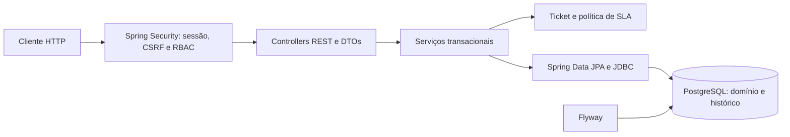
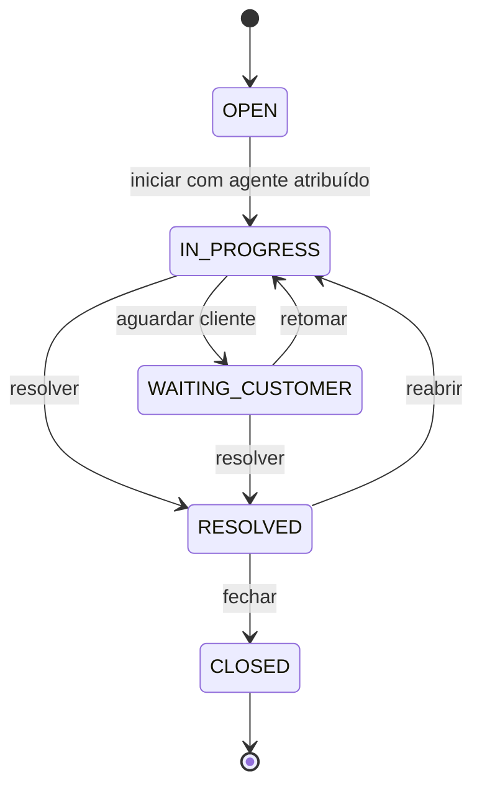
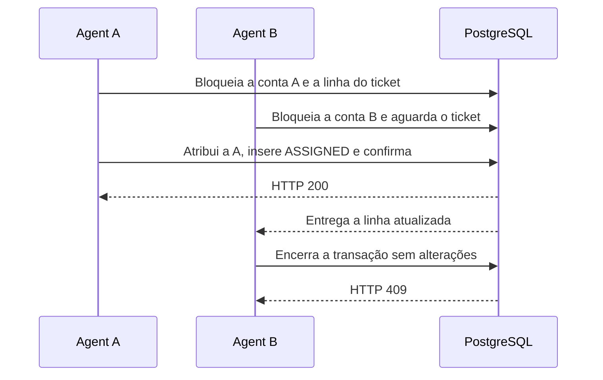
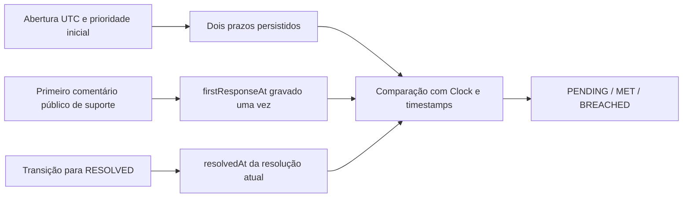

# Arquitetura

| Pacote | Responsabilidade |
| --- | --- |
| `auth` | Autenticação BCrypt, bootstrap, CSRF, sessão e verificação da conta em requisições autenticadas |
| `user` | Cadastro, identidade, criação de agentes e ativação administrativa |
| `ticket` | API de tickets, filtro da fila, transações, propriedade, atribuição e workflow |
| `comment` | Persistência e paginação de comentários com filtro de visibilidade |
| `sla` | Prazos por prioridade de abertura e classificação do resultado |
| `audit` | Escrita e consulta paginada de eventos de ticket |
| `shared` | Problem Details, formato de página e documentação OpenAPI |

## Ciclo do ticket

- O solicitante é obtido da sessão. A criação usa uma sequência PostgreSQL para `SUP-000001` e um UUID para FKs internas. A sequência pode apresentar lacunas após rollback.
- O agente responsável ou um administrador pode mudar status e prioridade. Qualquer agente ativo pode consultar e comentar na fila. O solicitante pode reabrir apenas o próprio ticket `RESOLVED` por ação explícita. Resolução é a avaliação do suporte. Fechamento encerra o ciclo.
- A atribuição e a prioridade podem mudar nos estados `OPEN`, `IN_PROGRESS` e `WAITING_CUSTOMER`. Desatribuir durante o atendimento é permitido. O ticket volta a aparecer na fila sem responsável.
- Comentários são aceitos até o fechamento. A consulta do solicitante seleciona somente registros `PUBLIC` no banco, inclusive na contagem da página. Nota interna preserva o `updatedAt` visível ao cliente. O histórico fica na API de suporte.

## Atribuição concorrente

O lock da conta de destino coordena atribuição e desativação. As duas operações que usam ambos os locks sempre adquirem a conta antes do ticket. Desativar um agente preserva as atribuições anteriores para triagem. Um administrador pode redistribuí-las. O lock do ticket também serializa prioridade, transições e comentários concorrentes.

## SLA

O instante igual ao prazo conta como dentro do SLA. Sem conclusão, o objetivo fica `PENDING` até passar o prazo. Espera pelo cliente consome horas corridas. Mudança de prioridade preserva os compromissos assumidos na abertura. Reabrir limpa `resolvedAt`, preserva a resposta, mantém o prazo original e registra a resolução anterior no evento `REOPENED`. O resultado reflete a resolução atual. O histórico guarda os ciclos anteriores. Breach é derivado na leitura e nos filtros da fila.

## API

Todas as mutações exigem CSRF. A sessão usa cookie `JSESSIONID` com `HttpOnly`, `SameSite=Lax`, expiração por inatividade de 30 minutos e `Secure` por padrão. O Compose de desenvolvimento usa HTTP restrito ao loopback. Login renova o ID da sessão e o token CSRF. Logout invalida a sessão. A versão de autenticação da conta impede o reaproveitamento de sessões anteriores mesmo se um administrador desativar e reativar a conta entre requisições.

| Prefixo | Operações | Acesso |
| --- | --- | --- |
| `/api/v1/auth` | `GET /csrf`, `POST /register`, `POST /login`, `GET /me`, `POST /logout` | Registro e login públicos com CSRF. `me` requer sessão |
| `/api/v1/tickets` | `POST`, `GET`, `GET /{reference}`, `GET/POST /{reference}/comments`, `POST /{reference}/reopen` | CUSTOMER, apenas tickets próprios |
| `/api/v1/agent/tickets` | `GET`, `GET /{reference}`, `POST /{reference}/claim`, `PATCH /{reference}/status`, `PATCH /{reference}/priority`, `GET/POST /{reference}/comments`, `GET /{reference}/history` | AGENT e ADMIN. Claim exclusivo de AGENT |
| `/api/v1/admin/tickets/{reference}/assignment` | `PUT` com `agentId`, `DELETE` para remover | ADMIN |
| `/api/v1/admin/users` | `GET`, `POST /agents`, `PATCH /{id}/status` com `active` | ADMIN |

Corpos JSON aceitos incluem `name`, `email`, `password` para cadastro, `title` e `description` para abertura e `body` e `visibility` para comentário. Campos desconhecidos geram 400. O servidor define autoria, papel e timestamps. As senhas de cadastro têm pelo menos 12 caracteres e até 72 bytes UTF-8. A aplicação normaliza endereços de e-mail ASCII para minúsculas e grava hashes BCrypt com custo 12.

A fila tem filtros `status`, `priority`, `assigned`, `requesterId`, `agentId`, `firstResponseSla` e `resolutionSla`. Para o cliente, os filtros são `status` e `priority` dentro do escopo da identidade. Ordenação usa `CREATED_AT`, `UPDATED_AT`, `FIRST_RESPONSE_DUE_AT` ou `RESOLUTION_DUE_AT` com `ASC` ou `DESC`. O desempate usa ID interno. As páginas retornam `items`, `page`, `size`, `totalElements` e `totalPages`.

Os erros seguem Problem Details. 400 indica formato inválido, 401 sessão ausente ou credencial incorreta, 403 papel insuficiente ou CSRF inválido, 404 recurso inexistente ou fora do ownership, 409 conflito de workflow, e 422 validação de entrada ou destino de atribuição inválido. Erros internos retornam uma mensagem genérica.

## Banco e observabilidade

Flyway aplica `V1__backend_foundation.sql`. Hibernate valida o schema na inicialização. Novas mudanças após adoção da V1 entram em migrations incrementais. FKs, unicidade e checks reforçam a integridade. `ticket_event` é append-only por trigger, sem atualização, deleção ou truncamento durante operações normais. Seu dono no banco continua com privilégios DDL. Consulte o [ADR de integridade](adr/003-ticket-integrity.md).

Actuator expõe saúde geral, readiness com estado da aplicação e conexão do banco, e metadados de versão da milestone. O log padrão usa JSON ECS e credenciais de bootstrap não são registradas. A implementação usa sessões em memória. Em múltiplas réplicas, o armazenamento de sessão deve ser compartilhado ou encaminhado de forma consistente.
