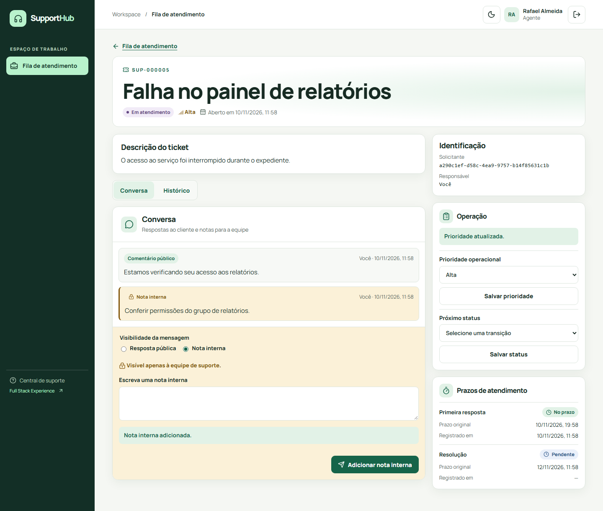
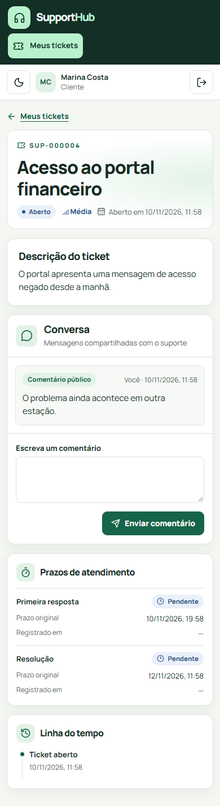

# Galeria · SupportHub Full Stack Experience

Capturas do Chromium headless durante o Playwright, com React, Nginx, Spring Boot e PostgreSQL em uma stack Compose descartável. As contas e os tickets são sintéticos.

## Fluxos

| Tela | Viewport | Evidência |
| --- | --- | --- |
| Login | 1440 × 960 | [Acesso e identidade visual](01-login.png) |
| Meus tickets | 1440 × 960 | [Listagem do cliente](02-meus-tickets.png) |
| Novo ticket | 1440 × 960 | [Formulário de abertura](03-novo-ticket.png) |
| Ticket do cliente | 1440 × 960 | [Conversa pública, prazos e linha do tempo](04-ticket-cliente.png) |
| Fila de atendimento | 1440 × 960 | [Filtros operacionais e resultados](05-fila-agente.png) |
| Workspace do agente | 1440 × 960 | [Resposta pública, nota interna e operação](06-workspace-agente.png) |
| Tema escuro | 1280 × 900 | [Workspace do agente no laptop](07-workspace-escuro.png) |
| Administração | 1440 × 960 | [Gestão de contas](08-administracao.png) |
| Tablet | 820 × 1180 | [Fila e filtros adaptados](09-tablet-fila.png) |
| Mobile | 390 × 844 | [Ticket do cliente em uma coluna](10-mobile-ticket.png) |

## Exemplos





## Reprodução no Windows

Após instalar as dependências npm e o Chromium, execute na raiz do repositório:

```powershell
pwsh -NoProfile -File scripts/fullstack-check.ps1 -GalleryDirectory .tools/fullstack-gallery
```

O script cria um volume novo, executa o smoke e captura as telas no diretório indicado. O teste mantém traces e vídeos desabilitados.
